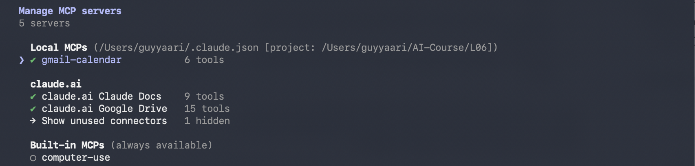
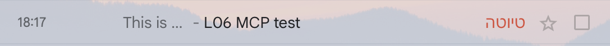
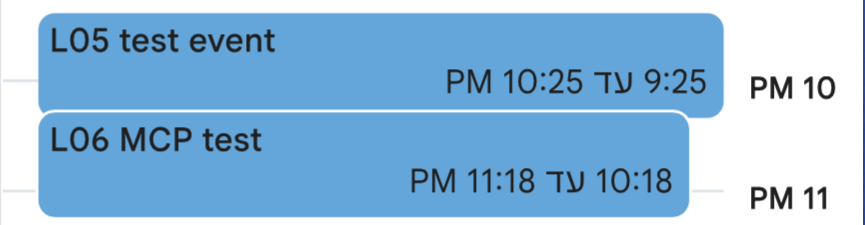

# gmail-calendar – שרת MCP ל-Gmail ול-Google Calendar

שרת MCP (Python, FastMCP, stdio) שחושף ל-Claude Code כלים לחיפוש וקריאה של מיילים, יצירת טיוטות, וניהול היומן.
במקום תוכנית שעושה פעולה קבועה (כמו ב-L05), השרת מציע "תפריט" של כלים, והסוכן בוחר בעצמו מה להפעיל ובאיזה סדר.

## הכלים (6)

| Tool | מה הוא עושה |
|---|---|
| `search_emails(query, max_results)` | חיפוש ב-Gmail בתחביר החיפוש של Gmail. מחזיר id, from, subject, date, snippet |
| `read_email(message_id)` | headers וגוף המייל המלא כטקסט (HTML מומר לטקסט) |
| `create_draft(to, subject, body, reply_to_message_id?)` | יוצר **טיוטה בלבד**. אפשר לשרשר כתשובה למייל קיים |
| `list_events(start, end)` | אירועים ביומן הראשי בטווח זמן |
| `check_availability(start, end)` | free/busy ביומן הראשי בטווח זמן |
| `create_event(summary, start, end, location?, description?)` | יוצר אירוע ביומן (בלי לשלוח הזמנות) |

**אין כלי לשליחת מייל, וזה בכוונה.** הסוכן יכול רק להכין טיוטה, ואדם מאשר ושולח ידנית ב-Gmail.
זמנים הם ב-ISO 8601; זמן בלי offset מתפרש כ-`Asia/Jerusalem`.

## דרישות מקדימות

- [uv](https://docs.astral.sh/uv/) ו-Python 3.11 ומעלה
- פרויקט ב-Google Cloud עם Gmail API ו-Google Calendar API מופעלים, ו-OAuth Client מסוג **Desktop app**
- תיקייה פרטית `~/my-private` מחוץ לפרויקט, שמכילה את קובץ ה-`client_secret*.json` שהורד מ-Google Cloud

Scopes: `gmail.modify`, `calendar`.

## התקנה

```bash
uv sync
```

בהפעלה הראשונה, אם אין `token.json` תקין, נפתח דפדפן להתחברות ל-Google, והטוקן נשמר ב-`~/my-private`.
אם הטוקן פג או בוטל, השרת חוזר אוטומטית להתחברות בדפדפן.

בדיקת עשן (קריאה בלבד – לא יוצרת, שולחת או מוחקת דבר):

```bash
uv run test_server.py
```

## רישום ב-Claude Code

מתוך תיקיית הפרויקט:

```bash
claude mcp add gmail-calendar \
  -e GOOGLE_PRIVATE_DIR="$HOME/my-private" \
  -- uv run --directory "$(pwd)" server.py
```

בדיקה: `claude mcp list`, או `/mcp` בתוך Claude Code.
שימו לב: הכלים נטענים רק כשהשיחה נפתחת, ולכן אחרי הרישום צריך להפעיל את Claude Code מחדש.

## דוגמאות לבקשות

- "What tools does the gmail-calendar server give you?"
- "Using only the gmail-calendar MCP tools: create a Gmail draft to me with the subject "L06 MCP test", and create a calendar event called "L06 MCP test" starting 4 hours from now, lasting one hour."
- "Find my latest email from Foresight, summarize it in two lines, and tell me if I am free tomorrow between 10:00 and 12:00."
- "Send an email saying hello." ← הסוכן מסרב (אין כלי שליחה) ומציע טיוטה במקום

כל ההנחיות האמיתיות מהתרגיל נמצאות ב-[prompts/](prompts/).

## איך הסודות נשמרים מחוץ ל-git

- `client_secret*.json` ו-`token.json` נמצאים רק ב-`~/my-private`, ולא בתיקיית הפרויקט.
- השרת קורא אותם בזמן ריצה דרך משתנה הסביבה `GOOGLE_PRIVATE_DIR` (ברירת מחדל: `~/my-private`).
- `.gitignore` מחריג `token.json`, `client_secret*.json`, `.env` ו-`.venv/` – כרשת ביטחון למקרה שקובץ כזה יגיע לתיקייה בטעות.
- השרת כותב לוגים רק ל-stderr ולא מדפיס תוכן של סודות.

## רפלקציה והנחיות

- [reflection.md](reflection.md) – מה בנינו, מה השתבש, בדיקת הגבול ומה למדנו
- [prompts/](prompts/) – ההנחיות ששימשו בתרגיל, עם הסבר ותוצאה לכל אחת

## צילומי מסך

**השרת מחובר ב-Claude Code (`/mcp`):**



**טיוטה שנוצרה ב-Gmail:**



**אירוע שנוצר ביומן:**


